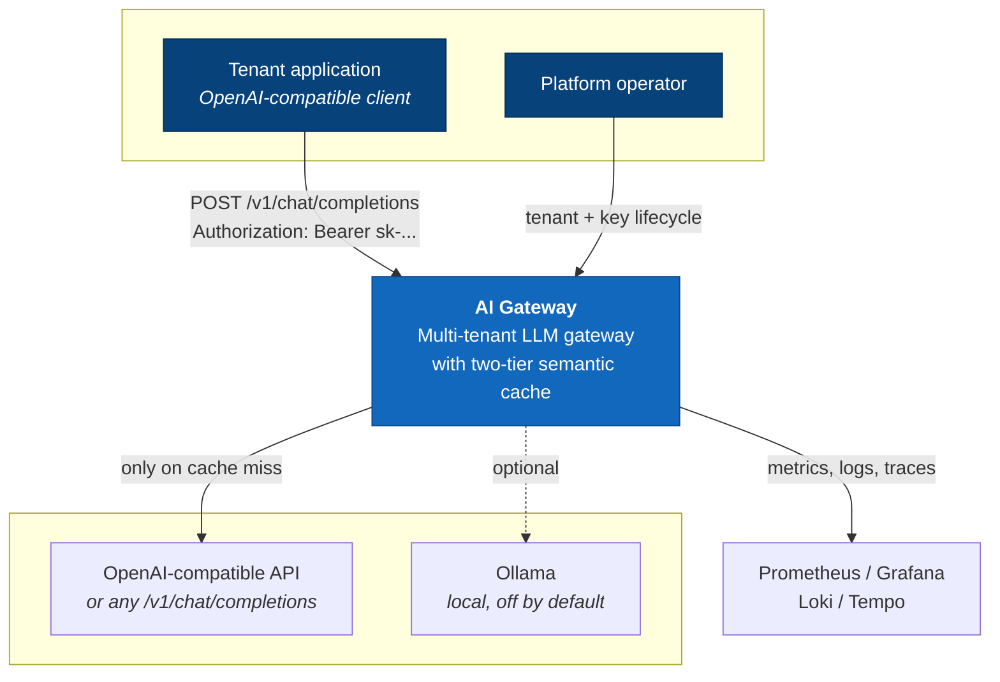
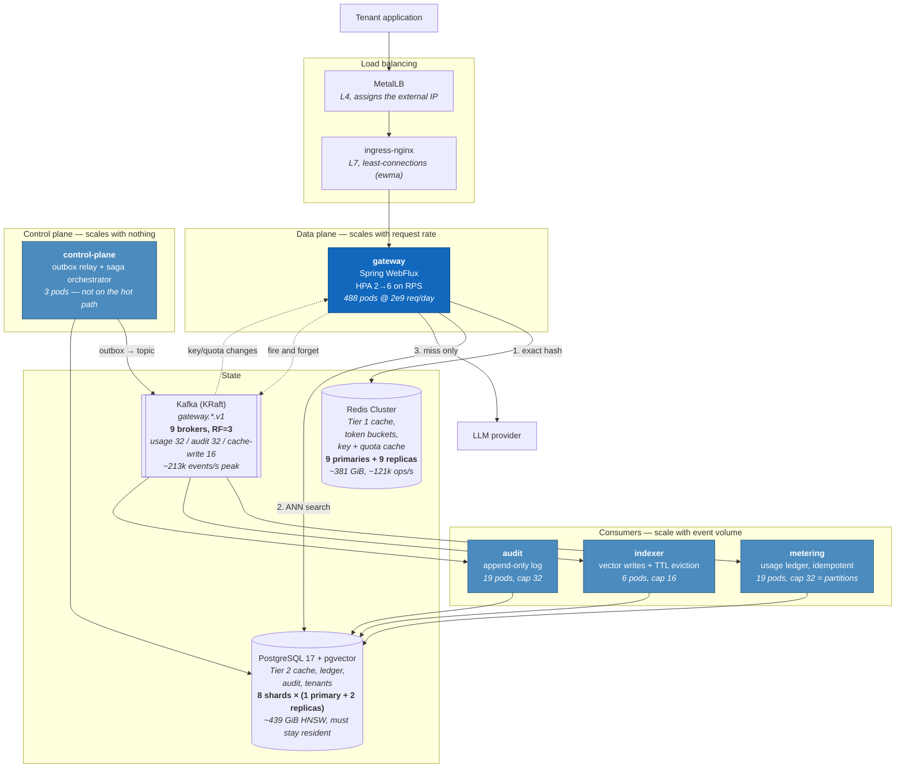
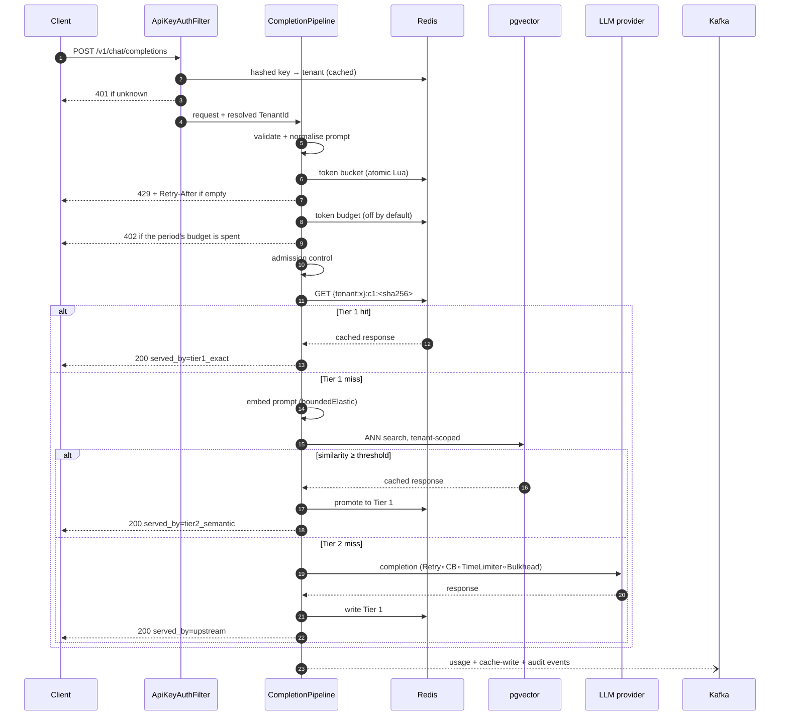
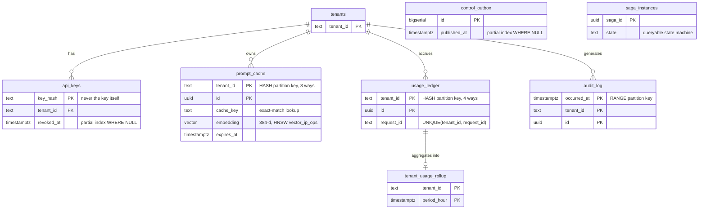
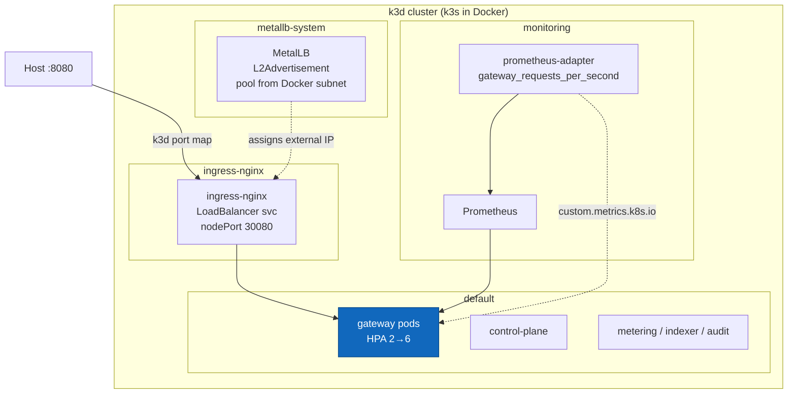

# High-Level Design

Multi-Tenant AI Gateway & Semantic Caching Middleware.

This document describes the system as built. Where the implementation differs from
the original blueprint the difference is stated and pointed at the ADR that records
why. Where something is designed but not yet built - whale-tenant sub-sharding, for
instance - it says so. A design document that describes intentions as though they
were code is worse than no document.

- **Low-level detail:** [LLD.md](LLD.md)
- **Scaling argument and measurements:** [scaling-model.md](scaling-model.md)
- **Decision records:** [../adr/](../adr/)
- **API contract:** [../api/openapi.yaml](../api/openapi.yaml)

---

## 1. The problem

An organisation running LLM features has three costs that grow linearly with traffic
and one that does not have to: **the same question gets asked over and over**.

Support assistants, documentation search, and internal copilots see enormous prompt
repetition — not identical strings, but *semantically identical questions*. "How do I
reset my password?" and "password reset steps?" want the same answer. An exact-match
cache catches the first kind of repetition and misses the second entirely.

This gateway sits between applications and LLM providers and answers three questions:

1. **Have I been asked this exact thing before?** (Tier 1, hash lookup, target < 2 ms)
2. **Have I been asked something that means the same thing?** (Tier 2, vector search,
   target < 15 ms)
3. If not — call the provider, and make sure one tenant's traffic cannot degrade
   another's.

It speaks the OpenAI chat-completions protocol, so existing clients point at it by
changing a base URL.

### Why this is a multi-tenancy problem first

The cache is the attack surface. If tenant A can read tenant B's cached answers the
product is not shippable at any scale, so tenant isolation is a property of the cache
key, the database partitioning, the rate limiter, and the vector search predicate —
not a filter applied afterwards. See [ADR-0006](../adr/0006-shard-key-is-tenant-id.md)
and §5 below.

---

## 2. System context (C4 Level 1)



The only inbound protocol is HTTP. The only outbound dependency on the request path
is the LLM provider, and that call is skipped entirely on a cache hit — which is the
entire point of the system.

---

## 3. Containers (C4 Level 2)

Five deployable services and two shared libraries. The split is along **failure and
scaling boundaries**, not along data entities: the gateway must scale with request
rate, the consumers scale with event volume, and the control plane barely scales at
all. Packaging them together would force one scaling decision on three workloads.



> **The counts in this diagram are (C) calculations for 2 billion requests/day**,
> derived in [`scaling-model.md` section 4b](scaling-model.md#4b-fleet-sizing-for-2-billion-requestsday)
> from one **measured** figure - a single 1000m pod serving >= 271.3 rps at a 0.696
> cache hit ratio - plus the assumptions stated there (10% distinct prompts, 2 KiB
> Redis entries, 4 KiB rows, 1 KiB Kafka messages, RF=3, 24 h retention).
>
> They assume the fleet scales approximately linearly, which the load campaign did
> **not** establish. Treat them as a sizing starting point, not as a verified capacity.

### Modules

| Module | Type | Purpose |
|---|---|---|
| `common` | library | Value types, cache key derivation, error taxonomy, hash ring, event contracts. **Framework-free** — enforced by ArchUnit. |
| `embedding` | library | ONNX/DJL inference, L2-normalised 384-d vectors, deterministic fallback |
| `kafka-support` | library | Producer/consumer factories, dead-letter publishing, partition-ordered runner |
| `gateway` | service | The request path: auth, rate limit, Tier 1, Tier 2, provider call, SSE |
| `control-plane` | service | Tenant and key lifecycle, transactional outbox relay, saga orchestration |
| `metering` | service | Usage ledger and hourly rollup, idempotent under redelivery |
| `indexer` | service | Writes vectors for Tier 2, evicts expired entries |
| `audit` | service | Append-only audit log, time-partitioned |

`common` being framework-free is load-bearing rather than tidiness: it is what makes
`CacheKey` and `ConsistentHashRing` testable without a Spring context, and those two
classes are where a bug is a security incident rather than a defect.

---

## 4. The request path



Four properties of this diagram are deliberate and each has a cost attached:

**The embedding happens in-process, not over the network.** A remote embedding API
costs 50–300 ms against a 15 ms Tier-2 budget — it would make Tier 2 slower than the
upstream call it exists to avoid. ONNX Runtime with `all-MiniLM-L6-v2` runs in ~3 ms.
[ADR-0002](../adr/0002-in-process-embeddings.md)

**Kafka is beside the request path, never inside it.** The blueprint drew the usage
event as an inline step. A broker round-trip adds ~3 ms to every request and breaks
SSE streaming, and the gateway's telemetry is not worth that: a dropped usage event
costs a fraction of a cent, while 3 ms on every request costs the latency budget.
Events are emitted fire-and-forget *after* the response. Where loss genuinely is
unacceptable — tenant provisioning, billing state transitions — the control plane
uses a transactional outbox instead. [ADR-0003](../adr/0003-kafka-beside-request-path.md),
[ADR-0008](../adr/0008-outbox-only-off-hot-path.md)

**The rate limiter is one atomic Lua script**, evaluated server-side in Redis. A
read-modify-write from the application would let two concurrent requests both observe
a non-empty bucket. The script also reads `redis.call('TIME')` rather than trusting a
client clock, because clock skew between gateway pods would otherwise make the limit
per-pod rather than per-tenant.

**Nothing on the hot path makes a synchronous call to another service.** Key and
quota changes arrive via Kafka and are served from local Redis, so the control plane
being down cannot make the data plane fail.
[ADR-0010](../adr/0010-no-synchronous-inter-service-calls.md)

### Measured behaviour

From a live run against real Redis and real pgvector (2026-11-02), single pod:

| Path | Measured | Target |
|---|---|---|
| Tier 1 miss (cold, upstream) | 62.9 ms | — |
| Tier 1 hit | 12.5 ms end-to-end, **3.94 ms** cache lookup | < 2 ms |
| Tier 2 semantic hit | **15.38 ms** | < 15 ms |

Tier 1 is over target. The cause is Redis running in WSL2, which adds a hop the
figure does not deserve to be blamed for — but the number stated here is the measured
one, not the one adjusted for the excuse.

Semantic matching, real similarity scores from that run:

| Prompt pair | Cosine | Outcome |
|---|---|---|
| Paraphrase | 0.9789 | **served from Tier 2** |
| Looser paraphrase | 0.8994 | correctly **refused** (threshold 0.95) |
| Unrelated | 0.1422 | refused |

---

## 5. Multi-tenancy and isolation

Isolation is enforced at four independent layers. Any one of them failing is
contained by the others.

**1. The cache key.** `CacheKey` is a SHA-256 over length-prefixed fields:

```
SHA-256( len(tenant) ‖ tenant ‖ len(model) ‖ model ‖ len(prompt) ‖ prompt ‖ … )
```

The length prefixes are the security property. Without them, concatenation is
ambiguous: `("acme", "gpt-4")` and `("acmeg", "pt-4")` would hash identically and one
tenant would read another's cached answer. `stream` and `Idempotency-Key` are
deliberately **excluded** — the same question streamed and buffered has the same
answer, and including a unique idempotency key would make every entry a miss.

**2. The Redis key space.** `{tenant:acme}:c1:<hex>`. The hash tag keeps a tenant's
keys in one Redis Cluster slot, which makes multi-key operations possible and keeps
one tenant's working set on one node.

**3. Database partitioning.** `prompt_cache` is `PARTITION BY HASH (tenant_id)` into
8 partitions and every query carries `tenant_id`, so the planner prunes to a single
partition. A vector search is therefore never cross-tenant *and* never cross-shard.
`usage_ledger` is hash-partitioned 4 ways on the same key.

**4. The rate limiter and budget.** Per-tenant token buckets, and a per-period token
budget that returns `402 BudgetExhausted` — distinct from `429 RateLimited` because
waiting does not help.

The budget is **off by default** and ships with shadow mode on, the same two-stage
roll-out as the semantic cache: it counts and reports what it *would* have refused
until an operator has seen that the limits refuse the right requests. The limit comes
from `tenants.quota_tokens`, published to Redis; until something publishes it, every
tenant resolves to the configured default. Enforcement is necessarily
check-before/record-after, because a completion's cost is not known until the
completion exists — so a tenant near its limit can overshoot by roughly (concurrent
requests × tokens each). `usage_ledger` in Postgres remains the exact, authoritative
record; the Redis counter is an enforcement figure allowed to be approximate at the
edges. A cache hit spends budget: a cache exists to lower the operator's cost, not to
make a tenant's entitlement unbounded.

Verified live: a request from tenant `globex` with the same prompt as a cached
`acme` entry did **not** receive it.

---

## 6. Data model



Three constraints in that diagram are the design rather than decoration:

- **`UNIQUE (tenant_id, request_id)` on `usage_ledger` is what makes billing correct.**
  Kafka delivers at least once; every consumer rebalance replays messages. The insert
  is `ON CONFLICT DO NOTHING` and the hourly rollup is incremented *only when a row
  was genuinely inserted*. Verified by forcing 18 redeliveries: 18 duplicates
  detected, **zero double-billing**, and the rollup stayed exactly equal to the ledger.

- **`audit_log`'s primary key and unique constraint both include `occurred_at`.**
  PostgreSQL requires every unique constraint on a partitioned table to contain all
  partitioning columns. The natural key would have been `(tenant_id, request_id)`;
  it is rejected outright.

- **`api_keys.key_hash` is the primary key and the plaintext key is never stored.**
  Lookup hashes the presented key. Comparison is constant-time — ArchUnit forbids
  `String.equals` in the auth package for exactly this reason.

- **`vector_ip_ops`, not `vector_cosine_ops`.** Embeddings are L2-normalised on
  creation, and for unit vectors inner product and cosine similarity are the same
  ordering. Inner product is cheaper, and the invariant is asserted in `Embedding`.

---

## 7. Scaling strategy

The honest summary: **this laptop cannot demonstrate billion-user throughput, and no
benchmark run on it should claim to.** What it can do is measure the per-node
scalability curve and extrapolate it with a model that exposes its own assumptions.
That is [scaling-model.md](scaling-model.md); the short version follows.

### Horizontal, by tenant

Shard key is `tenantId`, routed through a consistent-hash ring with ~150 virtual
nodes per shard. Because *every* cache lookup is tenant-scoped, a request touches
exactly one shard — there is **never a cross-shard ANN search**, which is the single
most expensive thing a vector-search system can be asked to do.
[ADR-0006](../adr/0006-shard-key-is-tenant-id.md)

The ring is immutable and copy-on-write, with shards sorted before hashing so that
every node computes an identical ring from identical membership. Adding a shard moves
approximately K/N keys.

> **Status:** implemented. `ShardRouter` owns shard membership and `ShardedDatabase`
> applies the key - every Tier-2 read and write routes through it, and reads prefer a
> replica. With no shards configured, every tenant routes to a single shard called
> `default` on the auto-configured datasource, so an unsharded deployment is
> unchanged. **Whale-tenant sub-sharding is still designed only.**

### Read replicas are safe here

Replica lag on the cache tables causes a **cache miss**, never a wrong answer: the
gateway falls through to the provider and re-caches. That is a latency cost on a
small fraction of requests, which is a very different risk profile from replica lag
on, say, an account balance. [ADR-0007](../adr/0007-read-replicas-are-safe.md)

### Autoscaling on request rate, not CPU

The gateway is I/O-bound. A pod waiting on an upstream LLM uses almost no CPU while
being completely saturated in useful work, so a CPU-driven HPA refuses to add pods
exactly when they are needed. The HPA targets `gateway_requests_per_second`, served
by prometheus-adapter, with a CPU target retained only as a high fallback.

The asymmetry in the scaling behaviour is deliberate: 30 s stabilisation scaling up,
300 s scaling down. Each new pod pays a ~16 s JVM start before serving anything, so
the cost of a surplus pod is far lower than the cost of a cold start under load.

### What breaks first

| Order | Limit | Symptom | Mitigation |
|---|---|---|---|
| 1 | pgvector HNSW recall/latency as a tenant's corpus grows | Tier 2 p99 climbs | Per-tenant partitions; tune `ef_search`; shard |
| 2 | Redis memory for Tier 1 | Evictions, hit rate falls | TTL + per-tenant caps; Cluster |
| 3 | PostgreSQL write throughput on the ledger | Consumer lag | Partition count; batch inserts |
| 4 | Upstream provider rate limits | 429s from the provider | Multi-provider fallback (built) |
| 5 | Kafka partition count vs consumer count | Lag that replicas cannot fix | Repartition before scaling consumers |

---

## 8. Resilience

Resilience4j decorators, in this order:

```
Retry( CircuitBreaker( TimeLimiter( Bulkhead( call ) ) ) )
```

The order is the design. Retry **outside** the circuit breaker means retries are
themselves subject to the breaker, so a failing provider does not get hammered by
retry traffic. TimeLimiter inside the breaker means a timeout counts as a failure and
can open it. Bulkhead innermost bounds concurrency against one provider so it cannot
consume the whole connection pool.

`ProviderRegistry` maintains an ordered fallback chain. Streaming responses are
guarded by an `AtomicBoolean` so a provider cannot be switched *mid-stream* — a client
receiving the first half of one answer and the second half of another is worse than
an error.

Verified live: the breaker opened after exactly 10 calls, rejected 18 further calls
without attempting them, and **all 14 user-facing requests were served via fallback**.

---

## 9. Failure modes and what the user sees

| Failure | Behaviour | Status |
|---|---|---|
| Redis down | Tier 1 bypassed, Tier 2 and upstream still serve | 200 |
| pgvector down | Tier 2 bypassed, upstream serves | 200 |
| One provider down | Fallback chain, next provider serves | 200 |
| All providers down | Breaker open, fast failure | 503, retryable |
| Provider slow | TimeLimiter fires | 504, retryable |
| Tenant over rate | Token bucket empty | 429 + `Retry-After` |
| Tenant over budget | Budget counter (off by default) | 402, **not** retryable |
| Budget store down | Fail-open by default; fail-closed yields a retryable 500 | 200 / 500 |
| Kafka down | Events dropped (data plane), outbox retains (control plane) | 200 |
| Control plane down | Data plane unaffected — no synchronous dependency | 200 |

`GatewayError` is a sealed interface, so adding a failure mode without mapping it to
an HTTP status does not compile. Every variant carries its own `retryable()` flag,
and `RateLimited.retryAfterSeconds()` is the single source of truth for the value —
the header and the message body disagreed once because they rounded independently.

---

## 10. Deployment



MetalLB does the real L4 allocation. On Windows and macOS its address is **not
routable from the host** — there is no route into the Docker bridge network — so the
Service's NodePort is pinned to 30080 and k3d maps host 8080 onto it. Both paths reach
the same Service; the host simply uses the one that works on its platform.

One Helm chart covers all five services, driven by four profiles:

| Profile | Contents | ~RAM |
|---|---|---|
| `dev` | gateway only, 1 replica, no HPA | 0.5 GB pods |
| `scale` | gateway 2→6 with the RPS HPA, ServiceMonitor on | 0.8–2.3 GB pods |
| `full` | all five services, both cache tiers, Kafka consumers | 2.2 GB pods |
| `obs` | overlay: ServiceMonitor only | — |

`full` **does not fit on a 7.4 GB laptop** alongside Docker Desktop. It is written
because it is the configuration the architecture describes; the file says so at the
top and suggests bringing services up in pairs instead.

---

## 11. Technology choices

| Area | Choice | Alternative rejected | ADR |
|---|---|---|---|
| Language | Java 21 | Kotlin — excluded by the user | — |
| Web stack | Spring WebFlux / Reactor / Netty | Virtual threads: no **backpressure** | [0001](../adr/0001-webflux-over-virtual-threads.md) |
| Embeddings | In-process ONNX + DJL, MiniLM 384-d | Remote API: 50–300 ms vs a 15 ms budget | [0002](../adr/0002-in-process-embeddings.md) |
| Vector store | PostgreSQL 17 + pgvector, HNSW | Dedicated vector DB: another system to run | — |
| Tier 1 | Redis, exact SHA-256 | — | — |
| Messaging | Kafka (KRaft), beside the request path | Inline: breaks SSE, +3 ms | [0003](../adr/0003-kafka-beside-request-path.md) |
| Pooling | r2dbc-pool, **no PgBouncer** | PgBouncer breaks server-side prepared statements | [0004](../adr/0004-no-pgbouncer.md) |
| Rate limiting | Token bucket, atomic Lua | Leaky bucket: real clients burst | [0005](../adr/0005-token-bucket.md) |
| Sharding | Consistent hash on `tenantId`, 150 vnodes | Modulo: rehashes everything on resize | [0006](../adr/0006-shard-key-is-tenant-id.md) |
| Durability | Outbox in control plane only | Outbox on the hot path: +3 ms | [0008](../adr/0008-outbox-only-off-hot-path.md) |
| Workflow | Orchestrated saga | Choreography: no queryable state | [0009](../adr/0009-orchestrated-saga.md) |
| Coupling | Zero synchronous inter-service calls | Service mesh of RPCs | [0010](../adr/0010-no-synchronous-inter-service-calls.md) |
| Default provider | `MockLlmProvider`; Ollama off | No GPU — 8–15 tok/s distorts benchmarks | [0011](../adr/0011-mock-provider-default.md) |
| L7 balancing | least-connections (`ewma`) | Round-robin, with 2 ms–30 s durations | [0012](../adr/0012-least-connections.md) |
| Scaling proof | USL fit at 1–6 pods | A headline RPS number | [0013](../adr/0013-usl-not-headline-rps.md) |

All free and open source. No paid service is required to build, test, scan or deploy
this system.

---

## 12. Quality and verification status

| Area | State |
|---|---|
| Build | 10 modules, Maven, Java 21 |
| Static analysis | SpotBugs **clean**, PMD **clean**, CPD clean, all 10 modules |
| Architecture tests | 9 ArchUnit rules: no `block()`, no `Thread.sleep`, no static `Instant.now()`, layering, `common` framework-free, no `String.equals` in auth |
| Coverage | **51.7% line / 49.1% branch** against an 80% gate. `metering` and `audit` 100%, `common` 89.6%, `gateway` **32.7%** — the gap |
| Mutation | PITest configured, **not yet run** |
| Integration | Testcontainers: metering, audit, indexer (pgvector), control-plane outbox |
| SonarQube | **never actually run** - the CI step was silently skipped by a broken `if` guard (now fixed); blocked locally (needs ~2.5 GB) |
| Images | 5 images, Trivy-scanned before push, published to GHCR + Docker Hub |
| Container | 309 MB, uid 10001, read-only root, 263 MB of a 512 Mi limit |

The coverage number is the one that matters and it is below the gate. The gate is
left at 80% and the job reports failure rather than being lowered to match reality.

---

## 13. Known gaps

Stated plainly, because a design document that hides them is a liability:

1. **Whale-tenant sub-sharding is designed, not built** (P7). The ring now routes
   every Tier-2 read and write, but one enormous tenant still lands on a single
   shard. `ShardRouter.route(String)` accepts a `tenant#bucket` key; nothing
   computes those buckets yet. Nothing alarms on replica lag either.
2. **The mutation score has never been measured** (P11). PITest is configured and
   now runs as its own job in both CI systems, but it has not yet executed once, so
   there is no mutation score in this repository and none should be quoted. That
   matters more here than the line-coverage number: for a cache whose dangerous
   failure is "returns the wrong tenant's answer" rather than "throws", a killed
   mutant is the only evidence an assertion would have noticed.

   Coverage itself is uneven rather than low. `gateway` is at **89.5% line / 87.5%
   branch** and `Tier2SemanticCache` — previously the one class below the gate at
   100 missed lines — is at 96.9%, covered by `Tier2SemanticCacheIT` against real
   pgvector. But `common` (66.1%), `embedding` (61.1%) and `kafka-support` (26.0%)
   are all under the 80% gate, which is why `coverage-gate` is still advisory; and
   `control-plane`, `metering`, `indexer` and `audit` have **no unit tests at all**,
   one Testcontainers IT each. Within `gateway`, `CompletionHandler` and
   `SqlUsageQueryService` are at 0%.
3. **A streamed response spends no budget** (P3). The token budget is *checked* on
   the streaming path, so an already-exhausted tenant cannot open new streams, but it
   is never *drawn down* - the token count is not available without buffering the
   response, which is the very thing that path exists to avoid - the same trade-off
   that stops the streaming path populating the cache, recorded in
   `CompletionPipeline.stream()`. A tenant that streams exclusively is bounded by the
   rate limiter
   and not by its budget. Closing it means counting tokens from the deltas as they
   pass - which needs counting, not retention - or requiring
   `stream_options.include_usage` and reading the terminal usage frame. Neither is
   implemented, so `usage_ledger` is the only complete record of what a streaming
   tenant consumed.
4. **No cluster run has happened yet** (P8/P12). The chart and scripts are verified
   by `helm lint`, rendering and syntax checks only — k3d is not installed and this
   machine has had between ~269 MB and ~1 GB free against the ~2 GB the cluster needs.
5. **Observability is written but not run** (P10). Prometheus, Grafana,
   prometheus-adapter, Loki, Tempo and Alloy are all configured under
   `deploy/k8s/observability/`, with two generated Grafana dashboards whose every
   metric CI verifies to exist. Nothing has been installed, because that needs the
   cluster from gap 4.
6. **No load campaign has been run** (P12), so every scaling claim in
   [scaling-model.md](scaling-model.md) is a model, not a measurement, and is labelled
   as such. The tooling and the USL fitter are written and the fitter is tested; what
   is missing is the cluster from gap 4.
7. **The control plane has no HTTP API yet.** `OutboxRelay` and `SagaOrchestrator`
   exist; tenant and key administration is not exposed over HTTP. The data plane is
   fully specified in [../api/openapi.yaml](../api/openapi.yaml), including the
   tenant usage reads the dashboard uses.
8. **The dashboard holds its API key in the bundle.** Anything in a `VITE_` variable
   is compiled in and visible to every user, so the dashboard is a local-development
   tool as it stands. A hosted one needs a session cookie or a
   backend-for-frontend, and the gateway has no notion of a user session - so this is
   a gap rather than a configuration change.
9. **Per-tenant budget limits are not published yet** (P3). The gateway reads a
   tenant's limit from Redis and falls back to a configured default, but nothing writes
   the per-tenant value - the control plane has no HTTP API (gap 7) and its
   provisioning saga has no concrete steps. So enforcement works, and every tenant
   currently gets the same default. The only thing needed to make per-tenant limits
   real is a writer; no gateway change.
