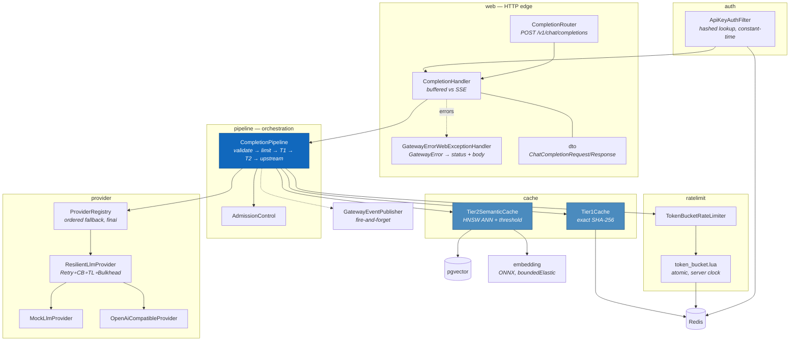

# Low-Level Design

Implementation detail for the system described in [HLD.md](HLD.md): the algorithms,
the concurrency model, the schema, and the specific places where a plausible-looking
alternative is wrong.

Every code excerpt here is taken from the repository, not written for the document.

---

## 1. Threading model

This is the constraint everything else is shaped by.

The gateway runs on Netty event loops — a small fixed pool, roughly one per core.
**Blocking an event loop thread stalls every request assigned to it**, not just the
one that blocked. There is no thread to steal.

Three rules follow, and all three are enforced mechanically rather than by review:

| Rule | Enforced by |
|---|---|
| No `block()`, `blockFirst()`, `blockLast()` anywhere in main source | `ArchitectureRulesTest` |
| No `Thread.sleep`, no `new Thread` | `ArchitectureRulesTest` |
| No static `Instant.now()` — inject a `Clock` | `ArchitectureRulesTest` |

The third looks like a testability rule and is one, but it was added after ArchUnit
caught a static `Instant.now()` in `CompletionPipeline` minutes after it was written.

### Where blocking work goes

ONNX inference is genuinely CPU-bound and genuinely synchronous. It is pushed to the
bounded elastic scheduler:

```java
return Mono.fromCallable(() -> model.embed(text))
           .subscribeOn(Schedulers.boundedElastic());
```

`boundedElastic` is bounded on purpose — an unbounded pool under load creates
thousands of threads and dies of context switching rather than of the work.

### Predictor pooling

DJL's `Predictor` is **not thread-safe**. `OnnxEmbeddingModel` keeps a pool and
borrows one per call. A single shared predictor produces either corrupted output or
an exception under concurrency, depending on timing — the worst kind of bug, because
single-threaded tests pass.

```java
Criteria.builder()
    .optOption("pooling", "mean")
    .optOption("normalize", "true")
    // BERT needs THREE inputs: ids, attention mask AND token type ids.
    // Without this DJL sends two and the model fails at inference time.
    .optOption("includeTokenTypes", "true")
```

---

## 2. `common` — the framework-free core

No Spring, no Jackson-on-the-hot-path, no Reactor. Enforced by ArchUnit. This is what
makes the two security-critical classes testable in isolation.

### 2.1 `CacheKey` — length-prefixed hashing

The class where a bug is a cross-tenant data leak.

```java
private static void putString(MessageDigest digest, String value) {
    byte[] bytes = value.getBytes(StandardCharsets.UTF_8);
    putInt(digest, bytes.length);   // length prefix prevents (acme,gpt-4) == (acmeg,pt-4)
    digest.update(bytes);
}
```

Without the length prefix, field concatenation is ambiguous and two different tenants
can produce the same digest. With it, the boundary between fields is unforgeable.

Fields included: `tenantId`, `modelId`, normalised prompt, `temperature`, `topP`,
`maxTokens`, serialised tools.

Fields deliberately **excluded**:

- `stream` — the same question streamed and buffered has the same answer. Including it
  would halve the hit rate for no benefit.
- `idempotencyKey` — it is unique per request by definition. Including it would make
  every single lookup a miss, silently disabling the cache.

Redis key format: `{tenant:acme}:c1:<64 hex chars>`. The `{...}` is a Redis Cluster
hash tag; it keeps one tenant's keys in one slot.

### 2.2 `PromptNormalizer` — three decisions that look like details

```java
// NFC, not NFKC.
Normalizer.normalize(input, Normalizer.Form.NFC)
```

- **NFC rather than NFKC.** NFKC is the aggressive form: it rewrites `x²` to `x2` and
  `fi` to `fi`. For a cache key that is a *semantic* change — `x²` and `x2` are
  different mathematics — so NFKC would merge prompts that must stay distinct.
- **Internal whitespace is preserved.** Collapsing runs of spaces is the obvious
  normalisation and it is wrong here: indentation is semantic in code, and a large
  share of LLM prompts contain code. Only leading and trailing whitespace is stripped,
  using the Unicode-aware `\p{IsWhite_Space}` rather than `String.trim()`, which only
  knows about ASCII control characters.
- **Case is preserved.** `SELECT` and `select` can mean different things, and
  lowercasing would damage every non-English prompt in ways that are hard to predict.

Length is measured in **code points**, not `String.length()`, so a limit is not twice
as strict for an emoji or for most non-Latin scripts.

### 2.3 `ConsistentHashRing`

```
hash(shardId + "#" + vnodeIndex) → position on a 2^32 ring
```

- **~150 virtual nodes per shard.** With one node per shard, random hashing gives
  wildly uneven load; ~150 brings the standard deviation to a few percent.
- **Immutable and copy-on-write.** A ring mutated while being read is a correctness
  bug under concurrency, and routing is on the hot path.
- **Shards are sorted before the ring is built**, so every node computes a byte-identical
  ring from identical membership. Without that, two gateway pods could route the same
  tenant to different shards — and the symptom is a mysterious cache miss rate, not an
  error.
- **Linear probing on vnode collision**, so two shards hashing to the same position
  does not silently drop one.
- `routeWithReplicas(key, n)` walks clockwise to the next *n* distinct shards.

`MurmurHash3` is hand-written: fast, well-distributed, and no dependency. The tail
handling is a loop rather than a fall-through `switch`, which is the form that reads
as a bug to every reviewer and to PMD.

### 2.4 `GatewayError` — a sealed taxonomy

```java
public sealed interface GatewayError {
    int httpStatus();
    boolean retryable();
}
```

Sealed, so adding a failure mode without mapping it to a status does not compile.

| Variant | Status | Retryable | Why |
|---|---|---|---|
| `Unauthenticated` | 401 | no | |
| `Forbidden` | 403 | no | |
| `InvalidRequest` | 400 | no | A malformed request is never fixed by resending |
| `PayloadTooLarge` | 413 | no | Carries actual and limit code points |
| `RateLimited` | 429 | **yes** | Carries `retryAfter` |
| `BudgetExhausted` | 402 | **no** | Waiting does not help — the money is gone |
| `UpstreamUnavailable` | 503 | yes | |
| `UpstreamTimeout` | 504 | yes | Carries elapsed |
| `CircuitOpen` | 503 | yes | Carries provider |
| `Overloaded` | 503 | yes | Bulkhead full |
| `Internal` | 500 | yes | |

The `402` / `429` distinction is the interesting one: both mean "not now", but only
one is worth retrying, and a client that cannot tell them apart will retry a budget
failure forever.

`RateLimited.retryAfterSeconds()` exists because the `Retry-After` header and the
error message once disagreed — the header rounded up, the message truncated. One
method is now the only source of that number.

`GatewayException` is constructed as:

```java
super(message, null, false, false);   // no writableStackTrace, no suppression
```

Stack trace capture is the expensive part of an exception, and 429 and 503 are hot
paths under exactly the conditions where you can least afford it.

### 2.5 `GatewayEvents` — versioned contracts

Topics carry a version in the name, so a schema change is a new topic rather than a
silent incompatibility with running consumers:

```
gateway.usage.v1        gateway.cache-write.v1    gateway.audit.v1
gateway.tenant.v1       gateway.dead-letter.v1
```

### 2.6 A static-initialiser trap

```java
// VALID must be declared BEFORE CACHE: the CACHE constant's constructor reads it.
private static final Pattern VALID = Pattern.compile("...");
public static final ProviderId CACHE = ProviderId.of("cache");
```

Declared the other way round, `VALID` is still `null` when `CACHE` is initialised and
the class fails with `ExceptionInInitializerError` at bean creation — which surfaces
as an unrelated-looking Spring failure. Pinned by `ValueTypeConstantsTest`.

---

## 3. `embedding`

### `Embedding` — an enforced invariant

384-dimensional, **L2-normalised on construction**, and the invariant is asserted
rather than assumed. Because the vectors are unit length:

```java
// cosine(a,b) == dot(a,b) for unit vectors; clamped for float error
public double cosineSimilarity(Embedding other) { ... }
```

That identity is why the HNSW index uses `vector_ip_ops` (inner product) instead of
`vector_cosine_ops` — same ordering, less work.

`toPgVector()` renders `[a,b,c]` with no spaces, which is the literal format pgvector
parses.

> **Float32 note:** asserting equality at 1e-9 in tests is impossible here; observed
> error is ~3.4e-8. Tolerances are 1e-6.

### `OnnxEmbeddingModel` / `HashingEmbeddingModel`

`all-MiniLM-L6-v2`, 384-d, mean pooling, normalised.

`HashingEmbeddingModel` is a deterministic trigram feature-hashing fallback used when
no model file is present. It keeps the service *running* but it is **not semantic** —
and `EmbeddingService.isSemanticallyMeaningful()` returns `false` for it, so Tier 2
can refuse to serve rather than returning confident nonsense. A fallback that silently
degrades correctness is worse than one that announces it.

---

## 4. `gateway`

### 4.0 Components (C4 Level 3)



The layering is pinned by ArchUnit to exact packages — `web → pipeline →
cache/provider` — so `web` cannot reach into `cache` directly and a new outbound
dependency has to be added deliberately rather than by autocomplete.

### 4.1 `CompletionPipeline` — stage order

```
validate → rate limit → admission control → Tier 1 → Tier 2 → upstream → store
```

Rate limiting sits before any cache lookup. Reversed, a tenant hammering a cached
prompt would consume Redis and CPU without ever being limited — the limiter exists to
protect the gateway, not only the upstream.

A bug worth recording: the rate-limit call was initially eager.

```java
// Mono.defer, not the call directly: without defer the limiter is invoked when the
// chain is ASSEMBLED, not when it is subscribed, so it fires even for requests that
// are rejected earlier.
Mono.defer(() -> rateLimiter.tryConsume(tenantId))
```

### 4.2 The Tier-2 prompt-length guard

```java
private static final int TIER2_MAX_PROMPT_CHARS = 1_000;
```

MiniLM truncates at 256 tokens. Two *different* 5,000-character prompts that share an
opening paragraph therefore produce **identical** embeddings, and Tier 2 would serve
one tenant's long document analysis in response to another question with the same
preamble. This is a correctness guard, not an optimisation: above the limit Tier 2 is
skipped entirely.

### 4.3 `Tier2SemanticCache` — two SQL traps

```sql
SELECT id, ..., -(embedding <#> CAST(:query AS vector)) AS similarity
  FROM prompt_cache
 WHERE tenant_id = :tenantId
   AND expires_at > now()
 ORDER BY embedding <#> CAST(:query AS vector)
 LIMIT 1
```

**`CAST(:query AS vector)`, never `:query::vector`.** Spring's named-parameter parser
treats `::` as its own marker and mangles the statement before PostgreSQL ever sees
it. The `CAST` form is equivalent and survives.

**The negation is required.** pgvector's `<#>` returns the *negative* inner product so
that smaller sorts first. `ORDER BY` wants the raw operator; the similarity *value*
needs the sign flipped. Getting this wrong does not throw — it silently ranks the
*least* similar entry first, and the cache returns confident garbage.

The threshold is applied **in Java, not in SQL**, so shadow mode can record what it
*would* have served without changing what it does serve. Nullable columns are read
through `orDefault()`; five nullable-unboxing NPEs were found here and in
`OutboxRelay` by SpotBugs.

### 4.4 `token_bucket.lua`

Atomic because Redis runs a script against a single key without interleaving.

```lua
local clock = redis.call('TIME')
local nowMillis = (tonumber(clock[1]) * 1000) + math.floor(tonumber(clock[2]) / 1000)
```

Three decisions inside the script:

- **Server time, not client time.** Gateway replicas sit on different nodes with
  independently drifting clocks. If each passed its own wall clock, a pod running fast
  would persist a future timestamp and every other pod would then compute negative
  elapsed time and refill nothing. Redis is the one clock all replicas already share.
  (Safe since Redis 5, where effects replication is the default, so replicas receive
  the resulting writes rather than the non-deterministic script.)
- **First contact starts the bucket full.** Starting empty makes a tenant's very first
  request fail, which is indistinguishable from an outage from their side.
- **Negative elapsed time is clamped to zero.** It should be impossible now that time
  comes from the server, but an NTP correction or VM migration stepping the clock
  backwards would otherwise *subtract* tokens.

Returns `{allowed, remaining, retryAfterMillis}` — the exact wait, so a well-behaved
client backs off correctly instead of guessing and worsening the overload.

### 4.5 `ProviderRegistry` and `ResilientLlmProvider`

```
Retry( CircuitBreaker( TimeLimiter( Bulkhead( call ) ) ) )
```

Retry outermost means retries are themselves subject to the breaker. TimeLimiter
inside the breaker means a timeout counts as a failure and can open it. Bulkhead
innermost bounds concurrency per provider.

`ProviderRegistry` is `final` (SpotBugs finding: a non-final class with an overridable
method called from the constructor) and builds its fallback chain synchronously —
an earlier version called `.block()` inside `chainFor`, on the hot path, which
ArchUnit now forbids outright.

Streams are guarded:

```java
// AtomicBoolean emitted: once a stream has produced its first element the provider
// is LOCKED IN. Switching mid-stream would splice two different answers together.
```

`OpenAiCompatibleProvider.extractDelta` was originally hand-rolled string slicing with
a cognitive complexity of 16; it is now Jackson parsing.

### 4.6 `ApiKeyAuthFilter`

- Accepts `Authorization: Bearer sk-...` and a bare header value.
- Looks up the **hash** of the presented key; plaintext keys are never stored.
- Comparison is constant-time. ArchUnit forbids `String.equals` and
  `java.util.Random` anywhere in the auth package.
- The resolved tenant is attached to the exchange and the Reactor context. The tenant
  is **never** read from the request body — accepting a client-supplied tenant id
  would let any caller read any tenant's cache.

### 4.7 `ArchitectureRulesTest` — the nine rules

1. No `block()` / `blockFirst()` / `blockLast()`
2. No `Thread.sleep`
3. No `new Thread`
4. No static `Instant.now()`
5. No `System.out` / `System.err`
6. Layering: `web → pipeline → cache/provider`, pinned to exact packages
7. `common` depends on no framework
8. No `String.equals` in the auth package
9. No `java.util.Random` in the auth package

---

## 4b. Shard routing

Three classes turn the ring from something that exists into something load-bearing.

### `ShardRouter` (`common`)

The ring is immutable; membership is not. The router holds the current ring in an
`AtomicReference` and swaps it wholesale:

```java
public boolean addShard(ShardId shard) {
    while (true) {
        ConsistentHashRing current = ring.get();
        if (current.shards().contains(shard)) {
            return false;
        }
        if (ring.compareAndSet(current, current.withShard(shard))) {
            return true;
        }
    }
}
```

A reader sees the ring before the change or after it, never a half-updated one, and
never blocks — which matters because every request routes. The compare-and-set loop is
not decoration: a plain get-then-set loses one of two concurrent updates, and a test
drives 32 concurrent additions to prove this one does not.

Removing the **last** shard throws. An empty ring cannot route, so a decommission would
otherwise become a total Tier-2 outage whose symptom is an exception on every request.

### `ShardedDatabase` (`gateway`)

```java
public DatabaseClient forRead(TenantId tenantId) {
    return clients.get(router.route(tenantId)).read();
}

public DatabaseClient forWrite(TenantId tenantId) {
    return clients.get(router.route(tenantId)).primary();
}
```

Reads may use a replica, writes may not. On this data replica lag produces a cache
**miss**, never a wrong answer ([ADR-0007](../adr/0007-read-replicas-are-safe.md)); a
write to a replica simply fails.

The test that matters asserts a tenant's read and write resolve to the **same shard**.
If those diverged, a write would land in one database while the lookup searched another
— a cache that never hits, with no error anywhere.

Replica selection is round-robin per shard:

```java
// Math.floorMod, not %. getAndIncrement overflows to Integer.MIN_VALUE eventually,
// and a plain % then yields a NEGATIVE index and an ArrayIndexOutOfBoundsException.
return replicas.get(Math.floorMod(next.getAndIncrement(), replicas.size()));
```

About two billion reads away — a fortnight at a few thousand requests a second, which
is long enough that it would only ever happen in production.

The counter lives per shard rather than once globally: with shards holding two and three
replicas, a single counter distributes unevenly across both.

### `ShardConfig` (`gateway`)

Builds a pooled `DatabaseClient` per primary and per replica, or falls back to the one
Spring Boot auto-configured when `gateway.sharding.shards` is absent — which is the
default, so an unsharded deployment is byte-for-byte unchanged.

Credentials are **not** per shard. The base options are applied last when building the
connection options, so `spring.r2dbc` credentials override anything a shard URL carries
and a shard entry cannot smuggle in a different user. These URLs live in a values file;
the credentials come from a Secret.

Pool sizes are 8 per primary and 4 per replica, against 16 for the unsharded case. Total
connections are **pods × shards × pool size**: 20 pods × 4 shards × 16 would open 1,280,
well past a default `max_connections` of 100 per shard. Sharding multiplies the
connection count, and the per-shard figure is the one that has to shrink.

Three mistakes refuse to boot — duplicate shard ids (the ring takes a `Set`, so they
would collapse silently and half the configured capacity would never be used), a shard
on the ring with no client (otherwise one tenant fails every request while all others
are fine), and an unparseable URL. The reverse — a client for a shard not on the ring —
is deliberately allowed, because a shard being drained is removed from the ring first
and torn down afterwards.

> **Not built:** whale-tenant sub-sharding. `ShardRouter.route(String)` accepts a
> `tenant#bucket` key, but nothing computes those buckets, so one enormous tenant still
> lands on a single shard.

---

## 5. `control-plane`

### 5.1 `OutboxRelay` — `FOR UPDATE SKIP LOCKED`

```sql
SELECT id, topic, partition_key, payload::text AS payload, attempts
  FROM control_outbox
 WHERE published_at IS NULL
 ORDER BY id
 LIMIT :batchSize
FOR UPDATE SKIP LOCKED
```

`FOR UPDATE` locks the selected rows; `SKIP LOCKED` makes other replicas step over
them and claim the next batch instead. The result is a **multi-replica-safe poller
with no leader election and no distributed lock** — the database is already a
consensus system, so adding one would be redundant.

Without `SKIP LOCKED` the replicas serialise behind one another: correct, but with
throughput equal to a single replica plus lock contention.

### 5.2 `SagaOrchestrator`

Orchestration, not choreography. `saga_instances` holds an explicit, queryable state
machine; steps run forward and compensations run **backwards** from the failure point.

The reason is operational rather than architectural purity: when a tenant is stuck
half-provisioned at 3am, "which step failed and what has been undone" is a single
`SELECT`. With choreography the same question requires reconstructing the state from
event logs across four services.

---

## 6. `metering` — where idempotency is the product

```sql
INSERT INTO usage_ledger (...) VALUES (...)
ON CONFLICT (tenant_id, request_id) DO NOTHING
```

The rollup is incremented **only when a row was genuinely inserted**. If the insert
was a no-op the rollup must not move, or redelivery inflates the bill.

Kafka delivers at least once; every consumer rebalance replays messages. So the
`UNIQUE (tenant_id, request_id)` constraint is not defensive programming — it is the
mechanism by which billing is correct.

**Verified** by forcing redelivery: 18 duplicates detected, **zero double-billing**,
and the rollup stayed exactly equal to the count of ledger rows.

> A testing trap found here: resetting a Kafka consumer group's offsets **requires the
> group to be `Empty`**. The first version of this test reset offsets while the
> consumer was still attached, the reset silently did nothing, and the test proved
> nothing while passing.

Coverage: **100%**.

---

## 7. `audit`

`PARTITION BY RANGE (occurred_at)`, quarterly partitions plus a `DEFAULT` catch-all.

```sql
PRIMARY KEY (occurred_at, tenant_id, id),
CONSTRAINT audit_log_idempotency UNIQUE (occurred_at, tenant_id, request_id)
```

PostgreSQL requires every unique constraint on a partitioned table to include **all**
partitioning columns. The natural key is `(tenant_id, request_id)`; it is rejected
with `unique constraint on partitioned table must include all partitioning columns`.
Hence `occurred_at` leading both constraints.

A 6-argument write method became an `AuditContext` record after a PMD finding.

Coverage: **100%**.

---

## 8. `indexer`

- `VectorIndexer` — consumes `gateway.cache-write.v1`, embeds, writes the vector row.
- `EvictionJob` — `fixedDelay`, batched `DELETE ... LIMIT`. Batched because an
  unbounded `DELETE` on a large partition takes a long lock and blocks the request
  path; a bounded batch run repeatedly does the same work without the stall.

---

## 9. `kafka-support` — partition-ordered consumption

```java
receiver.receive()
    .groupBy(record -> record.receiverOffset().topicPartition())
    .flatMap(group -> group.concatMap(this::handle))
```

This exact shape matters:

- `receive().flatMap(handler)` processes records concurrently across the whole
  subscription — fast, and it **destroys per-key ordering**.
- `receive().concatMap(handler)` restores ordering by processing strictly one at a
  time — correct, and it gives up all parallelism.
- `groupBy(partition)` then `concatMap` **within** each group gives ordering where
  Kafka actually guarantees it (inside a partition) and parallelism where it does not
  (across partitions).

`DeadLetterPublisher` sends exhausted records to `gateway.dead-letter.v1` rather than
dropping them or blocking the partition forever.

---

## 10. Schema summary

| Table | Partitioning | Key constraint | Index |
|---|---|---|---|
| `prompt_cache` | `HASH (tenant_id)` × 8 | `PK (tenant_id, id)` | HNSW `(embedding vector_ip_ops)`; `(tenant_id, cache_key)`; `(expires_at)` |
| `usage_ledger` | `HASH (tenant_id)` × 4 | `PK (tenant_id, id)`, `UNIQUE (tenant_id, request_id)` | `(tenant_id, occurred_at DESC)` |
| `tenant_usage_rollup` | — | `PK (tenant_id, period_hour)` | — |
| `audit_log` | `RANGE (occurred_at)` | `PK (occurred_at, tenant_id, id)`, `UNIQUE (occurred_at, tenant_id, request_id)` | `(tenant_id, occurred_at DESC)`; `(api_key_fingerprint, occurred_at DESC)` |
| `tenants` | — | `PK (tenant_id)` | — |
| `api_keys` | — | `PK (key_hash)` | partial `(tenant_id) WHERE revoked_at IS NULL` |
| `saga_instances` | — | `PK (saga_id)` | partial index on unfinished |
| `control_outbox` | — | `PK (id)` | partial `WHERE published_at IS NULL` |

The **partial indexes** are deliberate: an outbox index covering published rows grows
without bound and is never queried. `WHERE published_at IS NULL` keeps the index the
size of the backlog rather than the size of history.

### Flyway

```yaml
baseline-version: 0     # NOT the default of 1
```

With `baseline-on-migrate` on a shared, non-empty schema, the default baseline version
of **1** causes Flyway to treat `V1__*.sql` as already applied. It is skipped **with
no error and no warning** — `V1__metering.sql` never ran and nothing said so. Always
`baseline-version: 0`.

---

## 11. Build and quality configuration

```xml
<springdoc.version>2.10.0</springdoc.version>
```

Must stay on the 2.x line. springdoc 3.x targets Spring Boot 4 and drags in Boot 4
modular artifacts alongside Boot 3.5 — two `JacksonAutoConfiguration` classes and a
`BeanDefinitionOverrideException` at startup.

```xml
<coverage.line.minimum>0.80</coverage.line.minimum>
<coverage.branch.minimum>0.70</coverage.branch.minimum>
<mutation.threshold>70</mutation.threshold>
```

All JVMs — including surefire and failsafe — run with `-Duser.timezone=UTC`. Java
reports legacy zone ids such as `Asia/Calcutta`, both PostgreSQL drivers send the JVM
zone to the server as a session parameter, and slim container tzdata rejects it.

Two quality-gate failures worth recording because both were **silent**:

- **The JaCoCo gate was decorative.** `check` reads the module's own `jacoco.exec`,
  which `report-aggregate` never writes; and even against a merged file, `check` on a
  `packaging=pom` module analyses zero classes and passes. Enforcement moved per-module
  into `-Pquality`.
- **Failsafe was never bound to the lifecycle.** Every `*IT.java` test compiled and
  was silently never executed.
- **A PMD `<exclude>` in the wrong category is a no-op**, with no error.
  `AvoidFieldNameMatchingMethodName` is in `errorprone`; `UseUtilityClass` and
  `AvoidCatchingGenericException` are in `design`.

---

## 12. Container

Multi-stage, non-root (uid 10001), JRE-only runtime, read-only root filesystem with a
`/tmp` `emptyDir`.

`strip-native-libs.sh` removes non-`linux-x64` ONNX natives: **130 MB → 7 MB**. Two
traps inside it:

- The nested jar must be repacked **STORED** (`zip -0`). Spring Boot's loader requires
  nested jars to be uncompressed; recompressing them produces a jar that fails at
  startup.
- The glob must be `onnxruntime-[0-9]*`, not `onnxruntime-*`, which also matches DJL's
  `onnxruntime-engine-0.40.0.jar`.

```dockerfile
ENTRYPOINT ["java", "-jar", "app.jar"]
```

Not `JarLauncher`. Boot 3.3+ `jarmode=tools` extraction writes a thin `app.jar` plus
`lib/`, and `JarLauncher` then fails with `Could not find or load main class`.

```dockerfile
ENV JAVA_TOOL_OPTIONS="-XX:MaxRAMPercentage=70 ..."
```

A percentage, not `-Xmx`: the JVM reads the cgroup limit, so the same image is correct
at a 384 Mi limit and at 640 Mi. The remaining 30% is metaspace, thread stacks and —
for the gateway and indexer — the ONNX arena, which lives **outside** the Java heap.
That is why `values-full.yaml` raises the gateway to 640 Mi when Tier 2 is on: a
512 Mi limit leaves too little for the native allocation, and the result is an OOMKill
with no Java stack trace.

Measured: image 309 MB, running at 263 MB of a 512 Mi limit.

---

## 13. Test inventory

| Kind | Where | Notes |
|---|---|---|
| Unit | all modules | 21 test classes |
| Architecture | `gateway` | 9 ArchUnit rules |
| Integration | `metering`, `audit`, `indexer`, `control-plane` | Testcontainers, `*IT.java` via failsafe |
| Value-type invariants | `common` | Includes the static-init-order pin |
| Mutation | configured | **not yet run** |

Coverage, measured: **51.7% line / 49.1% branch** aggregate against an 80% gate.
`metering` and `audit` 100%, `common` 89.6%, `embedding` 60.7%, **`gateway` 32.7%**.

The gateway is the entire gap, and it is the module where a bug matters most. That is
the honest state, and it is the top of the P11 work.
