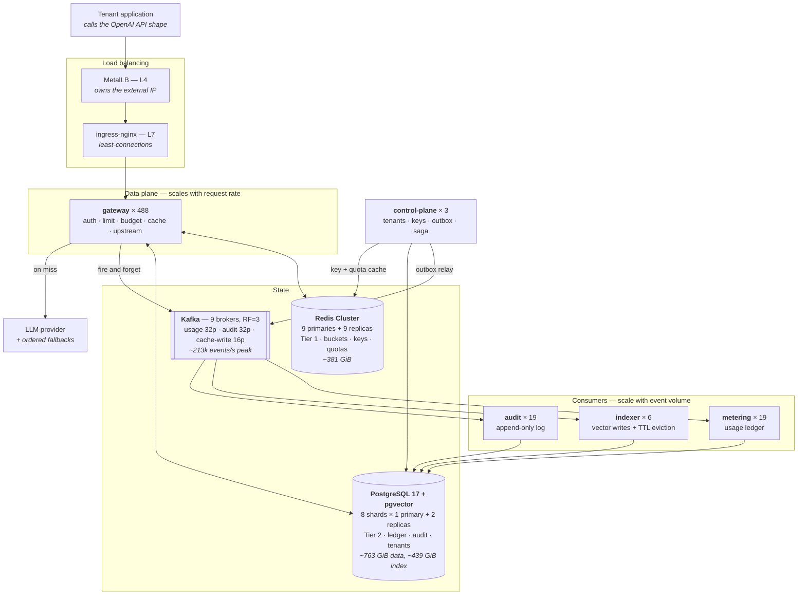

# B5 — High-Level Design

The system as a whole: the diagram, the request flow, every service and what
happens when it dies, Kafka and its partitions, how the caches actually store
data with real examples, the load balancer, observability, Helm, and some
scenarios.

Numbers marked **(M)** are measured, **(C)** calculated, **(A)** assumed.

---

## 1. The diagram



Two things to notice straight away:

- **Only the gateway is on the request path.** Everything below it consumes
  events *beside* the request, never inside it.
- **No arrow goes from one service to another.** They communicate only through
  Kafka and the database.

---

## 2. The request flow

One request, numbered, with the cost of stopping at each step.

```
POST /v1/chat/completions
  │
  1  MetalLB            packet enters the cluster
  2  ingress-nginx      pick the pod with fewest in-flight requests
  3  auth               SHA-256 the API key, look up tenant in Redis   -> 401
  4  validate           shape of the request                          -> 400
  5  rate limit         token bucket in Redis (Lua)                    -> 429
  6  budget             tokens left this period?                       -> refused
  7  admission control  too many in flight on this pod?                -> 503
  │
  8  TIER 1   Redis GET on the exact hash         --hit-->  respond  (2-5 ms) (M)
  │  miss
  9  embed    prompt -> 384 numbers               ~6 ms of CPU
 10  TIER 2   pgvector nearest-neighbour search   --hit-->  respond  (~100 ms) (M)
  │  miss
 11  UPSTREAM the real model, with fallbacks               (0.5-30 s)
  │
 12  write back into Tier 1 and Tier 2 (does not delay the response)
 13  respond
 14  fire-and-forget: usage event, audit event, budget drawdown
```

**Steps 3–7 are all cheap rejections, deliberately first.** Each step costs more
than the one before, so the order is arithmetic, not taste: it costs nothing to
say no, so say no before spending anything.

Full detail, including the Reactor subtleties, is in
[B4 — the request flow](B4-request-flow.md).

---

## 3. The five services, and what happens if each one dies

### gateway — 488 pods (C)

Everything on the request path: auth, rate limit, budget, both cache tiers, the
upstream call.

**If it fails:** this is the one that matters. Nothing works. Hence 488 pods
across many nodes, an HPA, and a PodDisruptionBudget so a rolling deploy cannot
take them all at once.

### metering — 19 pods, hard cap 32 (C)

Reads `gateway.usage.v1`, writes one row per request to `usage_ledger`, and
hourly rollups to `tenant_usage_rollup` — the table the dashboard reads.

**If it fails:** requests keep working. Nobody notices. Events pile up in Kafka
(it keeps them), and when metering comes back it reads from where it left off,
because `auto.offset.reset=earliest` and offsets are committed manually after
the write. **No billing data is lost** — Kafka is the buffer.

> Note the difference from the gateway's *publish* side: if **Kafka itself** is
> down, the gateway drops the event and it is gone. If only **metering** is down,
> Kafka holds the event and nothing is lost. See
> [B4a](B4a-failure-behaviour.md).

### indexer — 6 pods, hard cap 16 (C)

Reads `gateway.cache-write.v1` and writes vectors into `prompt_cache`. Also runs
TTL eviction.

**If it fails:** Tier 2 stops gaining new entries. Hit ratio slowly drops,
upstream cost slowly rises. Nothing breaks. Expired rows also stop being
evicted, so storage grows — the slow-burn failure, which is why there is a
metric for it.

### audit — 19 pods, hard cap 32 (C)

Reads `gateway.audit.v1`, appends to `audit_log`.

**If it fails:** same as metering. Kafka buffers; nothing is lost; requests are
unaffected.

### control-plane — 3 pods (C)

Tenants, API keys, budgets. The outbox relay and the saga orchestrator.

**If it fails:** you cannot create or revoke tenants and keys. Existing traffic
keeps working, because the gateway reads keys and quotas from Redis, not from the
control plane.

**Why only 3 pods:** it scales with *administrative* actions, not request rate.
Creating a tenant happens once. 488 copies of it would be absurd — which is
exactly the argument for splitting services on scaling boundaries rather than by
entity.

---

## 4. Kafka, and what partitions actually do

### The topics

| topic | partitions | producer | consumer | why that many |
|---|---|---|---|---|
| `gateway.usage.v1` | **32** | gateway | metering | one event per request — the highest volume |
| `gateway.audit.v1` | **32** | gateway | audit | one event per request |
| `gateway.cache-write.v1` | **16** | gateway | indexer | only on a miss, so ~30% of the volume |

9 brokers, replication factor 3, ~213k events/s at peak (C).

### What a partition is, plainly

A topic is split into partitions. Each partition is an ordered queue. **Kafka
gives each partition to exactly one consumer in a group.**

```
gateway.usage.v1
├── partition 0  ──► metering pod A
├── partition 1  ──► metering pod A
├── partition 2  ──► metering pod B
│   ...
└── partition 31 ──► metering pod S
```

Two consequences, and both bite people:

**1. The partition count is a hard cap on consumer pods.** With 32 partitions,
the 33rd metering pod is assigned **nothing**. It starts, joins the group, gets
no work, and sits idle looking perfectly healthy. Scaling past the partition
count does nothing at all.

> So: repartition the topic **before** scaling the Deployment. This is why the
> HPA for metering is capped at 32 and not left open.

**2. Ordering is per-partition, not per-topic.** The partition key here is
`tenantId`, so **all of one tenant's events land on the same partition** and
therefore stay in order relative to each other. Across tenants there is no
ordering, and nothing needs it.

### The consumer settings that matter

All in `KafkaFactory`, and each exists for a reason:

| setting | value | why |
|---|---|---|
| `enable.auto.commit` | **false** | the offset is committed *after* the database write. Auto-commit would acknowledge a record before it was stored, so a crash mid-processing loses it |
| `auto.offset.reset` | **earliest** | a redeployed service must not skip what piled up while it was down |
| partition assignor | **CooperativeSticky** | the eager default stops the *whole group* on every membership change, turning a rolling deploy into a series of stalls |

### The producer settings

`acks=all` with idempotence, and `max.in.flight ≤ 5`. Above 5, idempotence stops
guaranteeing order — a detail that is easy to raise "for throughput" and quietly
breaks ordering.

### Idempotent consumers

Writes use `ON CONFLICT DO NOTHING`. Kafka guarantees *at-least-once* delivery,
so a consumer **will** occasionally see the same record twice — after a rebalance
or a crash between the write and the offset commit.

Without idempotence that is double-billing. In testing, 18 duplicate deliveries
produced **zero** double-billing.

---

## 5. The caches: how they connect, how they store, how big

### How they are connected

```
                   ┌─────────────── gateway ───────────────┐
                   │                                       │
        1. GET exact hash                      2. nearest-vector search
                   │                                       │
                   ▼                                       ▼
      ┌────────────────────────┐          ┌────────────────────────────┐
      │ Redis Cluster          │          │ PostgreSQL + pgvector      │
      │ 9 primaries + 9 reps   │          │ 8 shards × (1 + 2 reps)    │
      │ TTL 1 hour             │          │ TTL 24 hours               │
      │ ~381 GiB               │          │ ~763 GiB + 439 GiB index   │
      └────────────────────────┘          └────────────────────────────┘
                                                        ▲
                                            writes come from the indexer
                                            (via Kafka), not inline
```

Tier 1 is checked first, then Tier 2. **A Tier-2 hit is promoted into Tier 1**,
so the next identical prompt costs 2 ms instead of another vector search.

### Tier 1 — what a Redis entry actually looks like

**Key:**

```
{tenant:acme}:prompt:9f86d081884c7d659a2feaa0c55ad015a3bf4f1b2b0b822cd15d6c15b0f00a08
```

- `{tenant:acme}` — the braces are a **Redis Cluster hash tag**. Redis hashes
  only what is inside the braces to pick a node, so every key for `acme` lands on
  the same node. That is what makes the rate limiter's multi-key Lua script legal
  — Redis refuses a script touching keys on different nodes.
- `9f86d081…` — SHA-256 of the normalised prompt plus model.

**Value** (JSON, TTL 1 hour):

```json
{"v":1,"c":"Paris is the capital of France.","m":"gpt-4o-mini","pt":12,"ct":8,"p":"openai","ts":1763049600000}
```

Notice the **one- and two-letter field names**. `v` is schema version, `c`
content, `m` model, `pt`/`ct` prompt and completion tokens, `p` provider, `ts`
created-at.

That is not laziness. At 2×10⁸ entries, using `"content"` instead of `"c"` costs
6 extra bytes × 2×10⁸ = **1.2 GB of RAM for nothing**. Across all seven fields
the full names would add roughly 8 GB.

And `v` earns its place: an entry written by an older schema is treated as a
**cache miss**, so the format can change without coordinating a cache flush.

### Tier 2 — what a PostgreSQL row actually looks like

```
tenant_id        | acme                                    <- partition + shard key
cache_key        | 9f86d081884c7d659a2feaa0c55ad015a3bf...
model_id         | gpt-4o-mini
embedding_model  | all-MiniLM-L6-v2                        <- vectors from different
                 |                                            models are incomparable
prompt_text      | user: What is the capital of France?
response         | Paris is the capital of France.
embedding        | [0.0123, -0.0456, 0.0789, ... ]         <- 384 floats = 1,536 bytes
prompt_tokens    | 12
completion_tokens| 8
provider         | openai
created_at       | 2026-11-15 10:00:00+00
expires_at       | 2026-11-16 10:00:00+00                  <- 24 h TTL
```

**Why `embedding_model` is stored:** vectors from two different models live in
incomparable spaces. A cosine of 0.99 between them is a plausible-looking number
that means nothing. Storing the model name and filtering on it means changing
embedding model makes old rows **invisible** rather than **wrong**.

**The table is `PARTITION BY HASH (tenant_id)` × 8.** Every query carries
`tenant_id` first, so the planner prunes to one partition and a search is
structurally unable to cross tenants.

**The index is HNSW with `vector_ip_ops`** — inner product. That equals cosine
similarity only for unit-length vectors, which is why embeddings are
L2-normalised on write. A non-normalised vector ranks *wrongly* rather than
failing.

### The lookup query

```sql
SELECT id, cache_key, response, model_id, prompt_tokens, completion_tokens,
       provider, created_at, prompt_text,
       -(embedding <#> CAST(:query AS vector)) AS similarity
  FROM prompt_cache
 WHERE tenant_id = :tenantId
   AND model_id = :modelId
   AND embedding_model = :embeddingModel
   AND expires_at > now()
 ORDER BY embedding <#> CAST(:query AS vector)
 LIMIT 1;
```

Three load-bearing details:

- **`<#>` returns NEGATIVE inner product.** Smaller is closer, so `ORDER BY`
  ascending gives the nearest row — and the `-(…)` flips it back into a
  similarity for the threshold comparison.
- **`CAST(:query AS vector)`, not `:query::vector`.** Spring's named-parameter
  parser treats `::` as a parameter marker and mangles the statement.
- **`tenant_id` first.** Partition pruning.

### Total storage, and where the numbers come from

```
Redis (Tier 1), 24 h of traffic:
  2e8 entries × 2 KiB/entry (A)        = ~381 GiB working set
  381 GiB ÷ 48 GiB usable per node     = 9 primaries (+ 9 replicas = 18)

PostgreSQL (Tier 2):
  2e8 rows × 4 KiB/row (A)             = ~763 GiB of row data
  2e8 × 2.3 KiB HNSW, M=16 (A)         = ~439 GiB of index
  439 GiB ÷ ~200 GiB usable RAM/node   = 3 shards minimum -> 8 chosen
```

Why a row is ~4 KiB: the embedding alone is 1,536 bytes, plus the prompt text and
the response.

**The 439 GiB figure is the one that drives the shard count, and it is the
system's real ceiling.** HNSW must stay resident in RAM. If it spills to disk,
Tier-2 latency goes from ~100 ms to seconds, and the cache becomes slower than
the thing it is caching. 8 shards were chosen over the minimum 3 for headroom.

> Every per-entry size above is marked **(A)** for assumed. They are the weakest
> numbers in the whole plan: nobody has measured the average entry size of real
> traffic. Halve the assumption and you halve the fleet.

### Eviction, and the failure that matters

Entries expire — 1 hour in Redis, 24 hours in PostgreSQL. Redis evicts on its
own; PostgreSQL rows need the indexer's `EvictionJob`.

The failure to watch for is `evicted_keys > 0` in Redis, which means the working
set outgrew `maxmemory`. The hit rate falls and upstream cost rises. **That is a
cost problem, not an outage** — which is the right direction to fail.

---

## 6. The load balancer

```
client → MetalLB (L4) → ingress-nginx (L7) → one of 488 gateway pods
```

**Two layers, because they do different jobs.**

**MetalLB** works at layer 4 (TCP). It owns an external IP address and gets
packets into the cluster. In a cloud, the provider's load balancer does this; on
bare metal or k3d, nothing does. **It is free**, which is why it is here.

**ingress-nginx** works at layer 7 (HTTP). It reads the `Host` header, matches
the route, terminates TLS, and chooses **which pod** gets the request. Only it
can make an intelligent choice, because only it can see HTTP.

### Least-connections, not round-robin — ADR-0012

Round-robin sends request N+1 to the next pod in the list regardless of what that
pod is doing. If a pod is stuck on a 30-second LLM call, round-robin keeps
sending it work.

Least-connections (nginx's `ewma`) sends the next request to whichever pod has
the fewest in flight.

**This system's request durations span 2 ms to 30 s — four orders of magnitude.**
Round-robin is fine when every request costs the same. Here it is not.

> A sick ingress is indistinguishable from a slow gateway. An `ingress-nginx`
> that has restarted many times will forward requests and time out upstream,
> returning 503 while the gateway is perfectly healthy. That corrupted one load
> test run here. Check its restart count before believing a latency number.

---

## 7. Observability — four services, four questions

| service | answers | how |
|---|---|---|
| **Prometheus** | *how much, how bad?* | scrapes `/actuator/prometheus` on every pod every 30 s |
| **Loki** | *what did it say?* | **Alloy** runs on every node, tails pod logs, ships them |
| **Tempo** | *where did the time go?* | gateway exports spans over OTLP **HTTP on 4318** |
| **Alertmanager** | *who needs waking?* | groups Prometheus alerts, sends to Slack |

Grafana sits in front of all four as the single UI.

Three things worth knowing:

- **`monitoring.serviceMonitor.enabled` defaults to `false`.** Without it
  Prometheus scrapes nothing of ours and every dashboard renders empty, with no
  error anywhere.
- **Tracing must point at port 4318 and the `/v1/traces` path, not 4317.** Spring
  Boot drives the OTLP *HTTP* exporter; 4317 is gRPC. Pointed at 4317 the
  dependency is present, sampling is set, the endpoint is populated — and zero
  spans arrive. That was broken here for months.
- **Alloy ships logs with the same `namespace` and `pod` labels the metrics
  carry**, which is what lets you pivot from a spike in a graph to the log lines
  behind it.

Sampling is 10% by default — tracing every request at target throughput would
cost more than the gateway.

Queries for all of these are in
[`observability-queries.md`](../runbooks/observability-queries.md).

---

## 8. Helm — one chart, many services

```
deploy/helm/ai-gateway/
├── Chart.yaml
├── values.yaml            defaults + every "why" as a comment
├── values-dev.yaml        gateway only, for a laptop
└── templates/
    ├── deployment.yaml    ONE template, looped over .Values.services
    ├── service.yaml
    ├── ingress.yaml
    ├── hpa.yaml           autoscaling on RPS
    ├── pdb.yaml           a rolling deploy cannot drain them all
    ├── networkpolicy.yaml
    ├── servicemonitor.yaml
    └── configmap.yaml
```

The five services share **one** Deployment template, driven by a loop over a
`services` map in `values.yaml`. Each service's entry sets its own replica count,
ports, resources and env; everything structural is written once.

```bash
helm upgrade --install aigw deploy/helm/ai-gateway \
  -f deploy/helm/ai-gateway/values-dev.yaml \
  --set global.imageTag=0.2.0-glibc \
  --set embedding.enabled=true \
  --set monitoring.serviceMonitor.enabled=true
```

**Redis and PostgreSQL are deliberately NOT in the chart.** In production they
are managed services or operator-owned StatefulSets with their own backup story.
Bundling them invites someone to run a chart-managed database in production.

> **`helm upgrade` failing with a field-manager conflict** means `kubectl patch`
> or `kubectl set` took ownership of a field. Server-side apply records an owner
> per field, and `--take-ownership` does not clear it. `helm uninstall` then
> `helm install` does.

---

## 9. Scenarios

Walk through these and the design explains itself.

### A — the same question, twice

1. First request: Tier 1 miss → embed → Tier 2 miss → upstream, 800 ms, you pay
2. Written into both tiers; a cache-write event goes to Kafka
3. Second request, identical bytes: **Tier 1 hit, 3 ms, free**

### B — the same question in different words

1. `"How do I cancel my subscription?"` → upstream, stored
2. `"steps to cancel my subscription"` → different bytes, so **Tier 1 misses**
3. Embedded, searched; similarity clears the threshold → **Tier 2 hit, ~100 ms**
4. The answer is also promoted into Tier 1, so a *third* identical rewording is
   3 ms

### C — a tenant floods you

1. Tenant `acme` sends 10,000 requests/second
2. Their token bucket empties; further requests get **429**
3. Every other tenant is unaffected — separate bucket, separate Redis keys
4. The bucket is in Redis, so the limit holds across all 488 pods, not per pod

### D — Redis dies

1. Tier-1 lookups fail → counted as misses → traffic falls through to Tier 2
2. The rate limiter cannot read its buckets → **fails open**, requests allowed
3. Requests still succeed: **slower and more expensive, not down**
4. The danger is quiet: the limiter is now off. There is a metric and an alert
   for exactly that

### E — Kafka dies

1. The gateway's publishes are dropped, counted in `dropped`
2. **Requests are completely unaffected** — publishing is fire-and-forget after
   the response
3. What you lose: that window of usage and audit records, permanently. See
   [B4a](B4a-failure-behaviour.md)

### F — the LLM provider dies

1. The primary provider errors or times out
2. The ordered fallback chain is tried
3. If all fail, **the request fails**. This is the one unavoidable failure — it
   is the component doing the actual work
4. Cached traffic keeps being served throughout, so a provider outage degrades
   you to "only answers questions we have seen before" rather than down

### G — one tenant is enormous (the known gap)

1. The ring spreads tenants evenly across 8 shards
2. It **cannot** spread *one* tenant — the shard key is `tenantId`
3. So a whale lands on a single shard and can exhaust it
4. Sub-sharding on `tenant#bucket` is designed and **not built**. It is not free:
   splitting by prompt hash breaks Tier 2, because similar prompts hash to
   unrelated buckets, so whale reads must fan out across all of them

### H — traffic doubles overnight

1. The HPA sees request rate rise and scales the gateway 2 → 6 (dev) or toward
   488 (production)
2. Redis and PostgreSQL do **not** autoscale. Adding a shard means moving data
3. Which is why the ring uses 150 virtual nodes per shard: it bounds how much
   data moves when a shard is added
4. The real limit is the HNSW index staying in RAM, not the pod count

---

## 10. What breaks first

A design document that will not name its own ceiling is a diagram.

1. **The HNSW index leaving RAM** (~439 GiB). Tier 2 goes from 100 ms to
   seconds; the cache becomes slower than the model.
2. **Kafka partition count** caps consumer pods at 32/32/16.
3. **One whale tenant on one shard** — scenario G.
4. **Embedding CPU, if Tier 2 is serving.** The 488-pod figure was measured with
   Tier 2 **off**. With it on, embedding dominates and per-pod throughput falls
   by one to two orders of magnitude. The fix is architectural — move inference
   onto the indexer that already exists — not more gateway pods. See
   [`tier2-measured.md`](../architecture/tier2-measured.md) §4.

---

## 11. Two of the HLD's own "known gaps" are stale

Checked on 2026-11-15, because a document claiming gaps it has closed costs
credibility exactly when someone is checking rigour:

- **Gap 2** says PITest "has not yet executed once, so there is no mutation
  score." It has since run as its own CI job, and the coverage figures quoted
  beside it are from an older run.
- **Gap 3** says "a streamed response spends no budget." Closed in code.
  `CompletionPipeline.stream()` draws it down two ways — the exact count from a
  terminal usage frame when the provider sends one, otherwise
  `BudgetGate.recordStreamed` counting characters. Both exist and are called.

Logged as work item A15.

---

**Next:** [B6 — the LLD](B6-lld.md).
**Previous:** [B4a — why a broken service does not break a request](B4a-failure-behaviour.md).
